# Odoo Procure-to-Ship Case Study

**Odoo ERP | Procurement | Manufacturing | Project Control**

A two-week procure-to-ship cycle run on real days inside a live Odoo 20 trial: purchase orders to five vendors, manufacturing orders against bills of materials, nine customer shipments across three carriers and accounts payable through close. It was managed as a 10-milestone project with a baseline, a RAID log, a KPI workbook and two status reports.

---

# Project Overview

A small manufacturer's numbers come from four places that rarely agree on their own: what was ordered, what arrived, what got built and what shipped. When one vendor runs late, the question is whether that slip reaches a customer, and whether the books still match at month end. This project runs that full chain for Hearth & Desk Supply Co., a fictional office-furniture maker, and tracks it the way a project lead would: a baseline schedule, each disruption logged as it happens, and KPIs reported against plan.

The setup: 5 vendors, 7 customers, 11 components, 4 finished goods with bills of materials, 15 reorder rules and 3 rule-based carriers. Work ran from 10/8 to 10/22/2026, one milestone at a time on the day it was scheduled.

---

# What's Inside

1️⃣ **Project control workbook** (`P2S_Project_Control.xlsx`): Charter, Milestones with a Gantt view, RAID log, KPIs and the dashboard. Every KPI is a formula on the exported Odoo data.

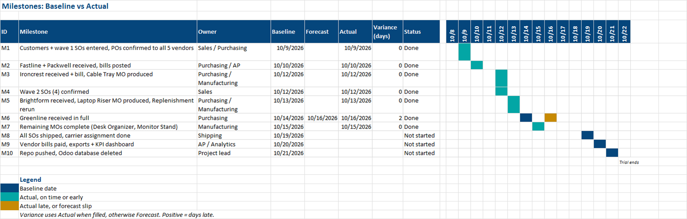

2️⃣ **KPI dashboard**: four tiles (PO cycle time, vendor on-time rate, MO schedule adherence, shipping cost per order) and four charts built on Excel Tables.

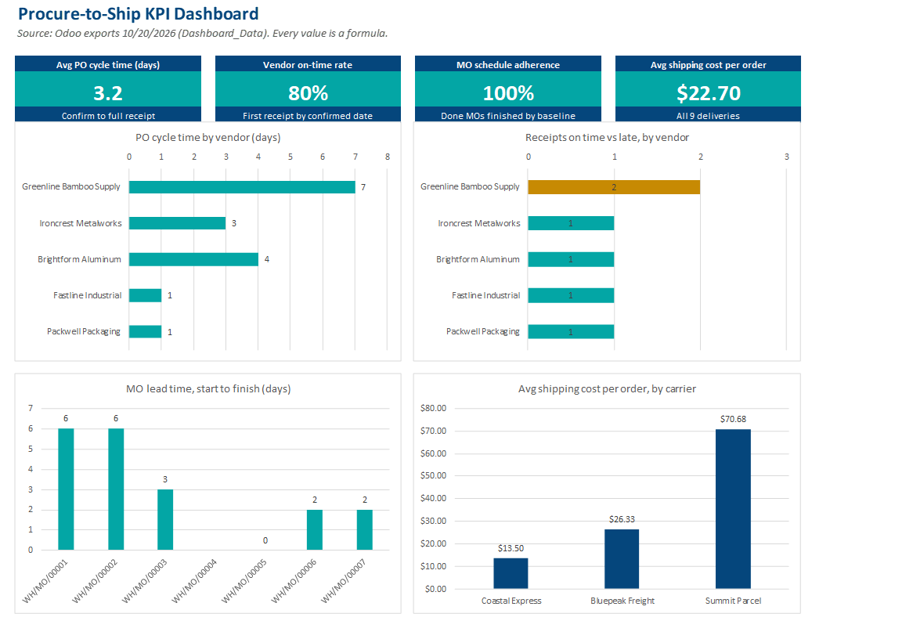

3️⃣ **Status reports**: #1 at mid-project (Amber, after the Greenline slip) and #2 at close-out, with final KPIs, the carrier mix and the unbilled-PO find.

4️⃣ **Data exports**: purchase orders, receipts, manufacturing orders, deliveries and vendor bills as CSV, pulled from Odoo before the trial database was deleted.

---

# Key Metrics

| Metric | Result |
|---|---|
| Customer OTIF | 100% (9 of 9 orders complete and on time) |
| Order cycle time | 7.7 days average, confirm to ship |
| Vendor on-time rate | 80% (Greenline missed by one day) |
| Vendor fill rate | 98.2% on first receipt |
| Avg PO cycle time | 3.2 days, confirmation to full receipt |
| MO schedule adherence | 100% of completed MOs on baseline |
| Avg shipping cost per order | $22.70 across 3 carriers |
| Schedule variance | 0.3 days average (M6 +2, M10 +1) |
| Issues logged and closed | 3 (a posting error, a late vendor, an unbilled PO) |

---

# How It Was Built

**1. Master data.** Products, vendor price lists, bills of materials, reorder rules and three carriers, each with its own pricing rule. Coastal Express only serves FL, GA, NC and SC.

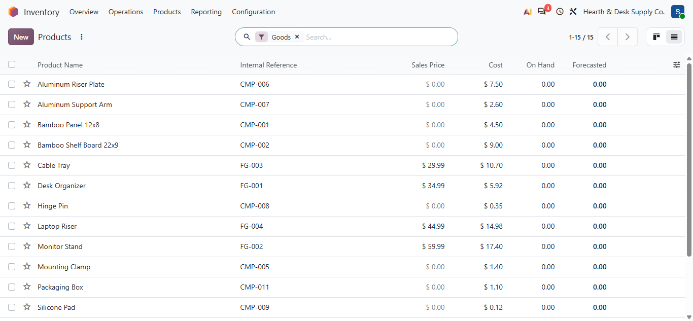

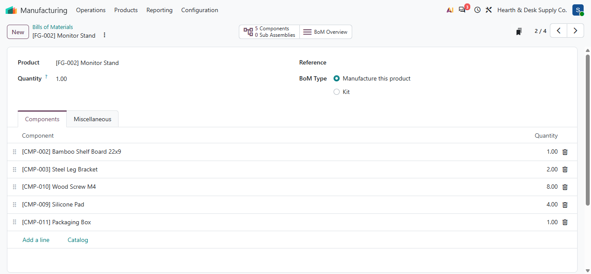

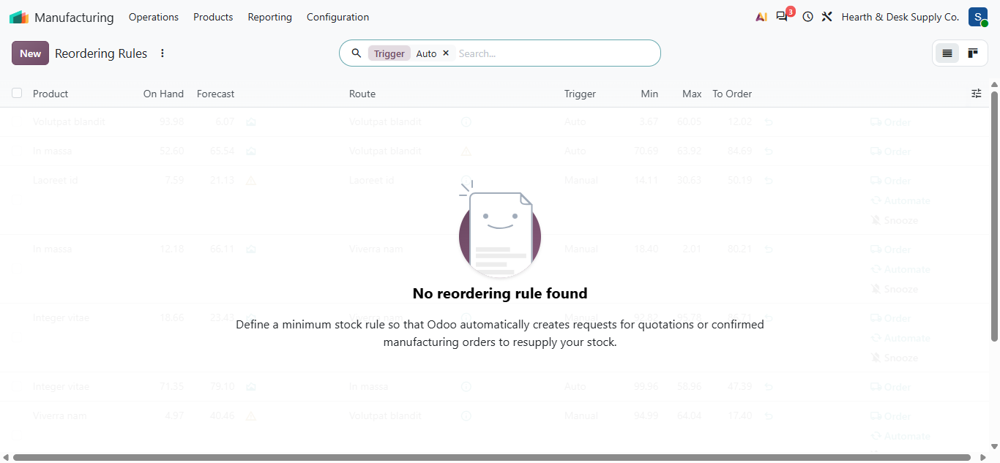

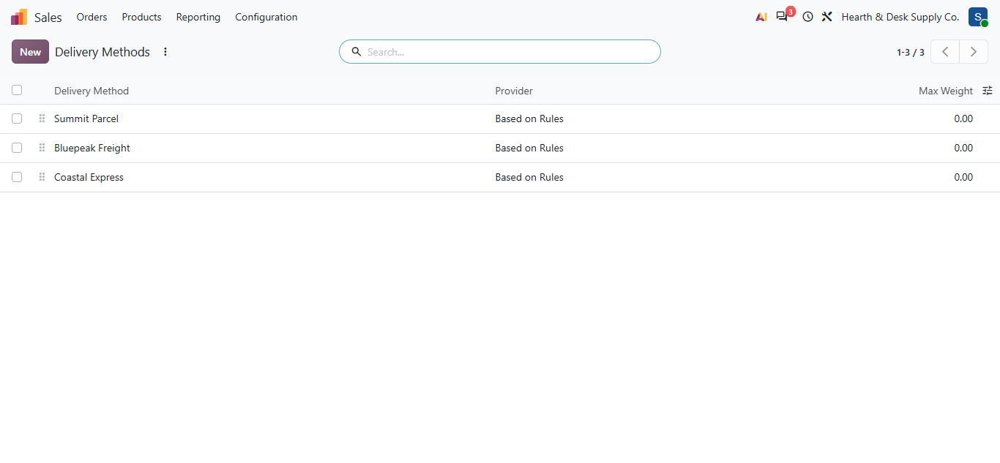

**2. Demand first, then purchasing.** Manufacturing orders were created before any component was ordered, so every PO quantity traces back to MO demand through the Replenishment report.

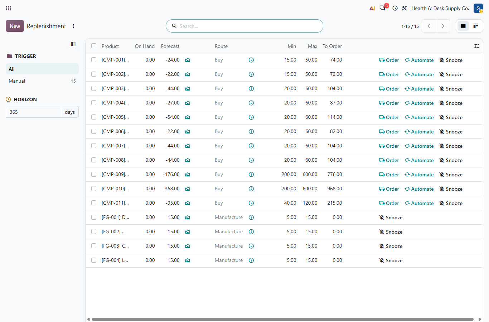

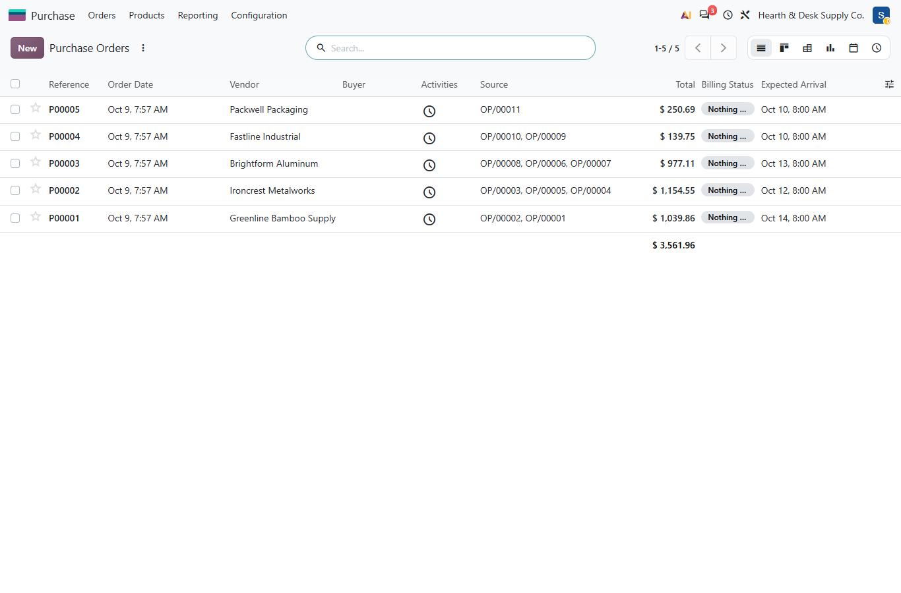

**3. A manufacturing posting error, fixed the same day (I1).** WH/MO/00004 consumed its components but recorded zero finished units. An inventory adjustment returned the components and a replacement MO produced the full 22.

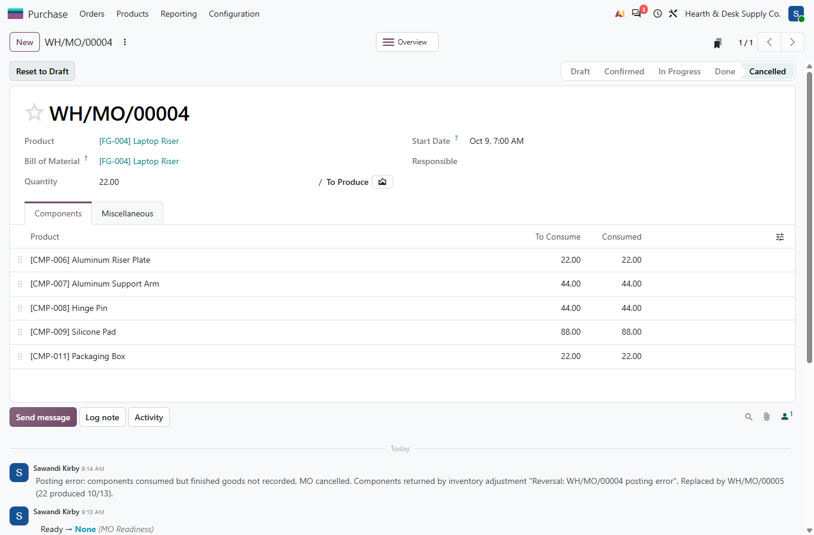

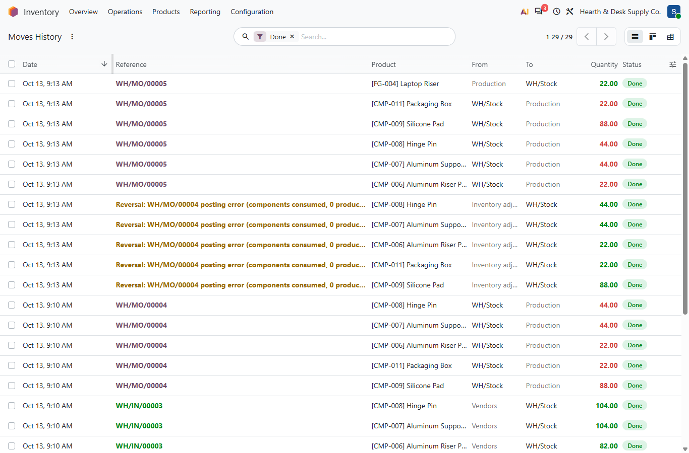

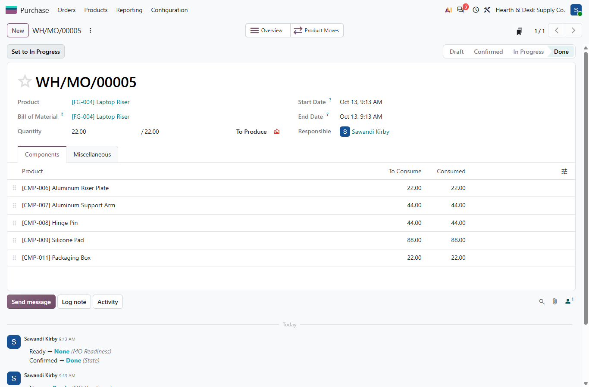

**4. A late vendor (I2).** Greenline Bamboo Supply missed its 10/14 date, sent a partial on 10/15 and shipped the backorder on 10/16. The partial covered every open MO, so no customer date moved.

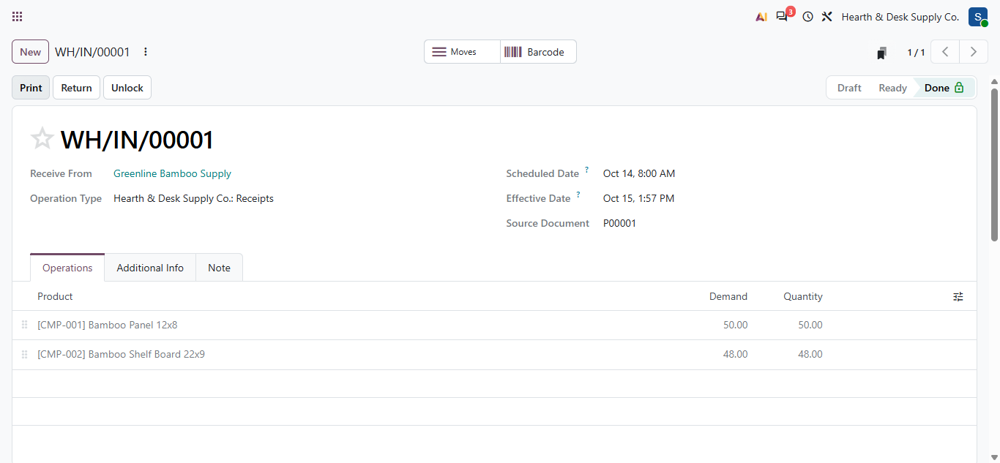

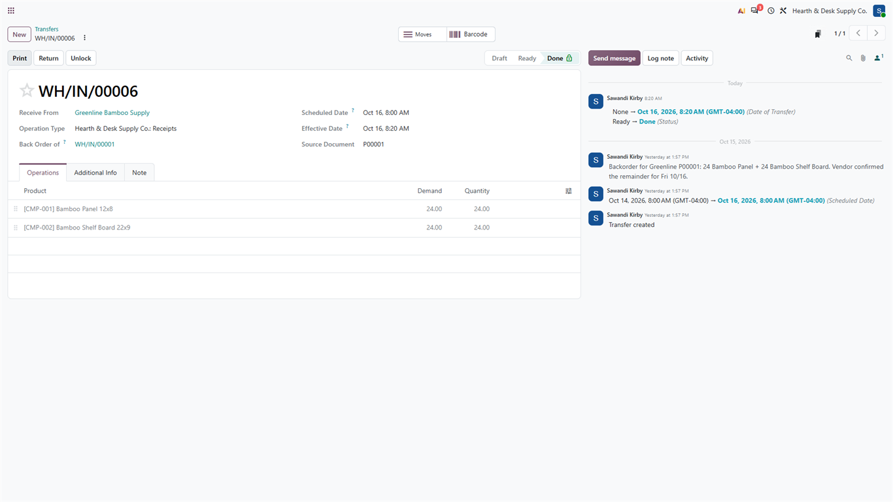

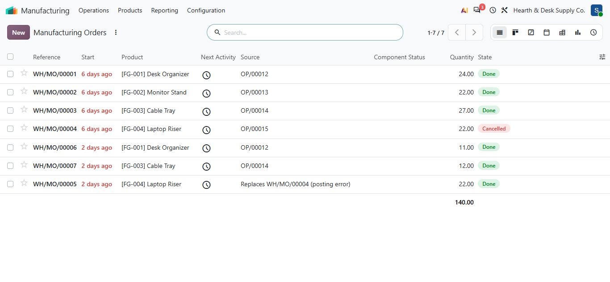

**5. Shipping and carrier choice.** Six orders went on Coastal Express. When the Kansas order was booked on Coastal, Odoo didn't raise an error: the carrier just didn't appear for that address. It was rebooked on Bluepeak Freight, the cheaper out-of-region rate for that weight.

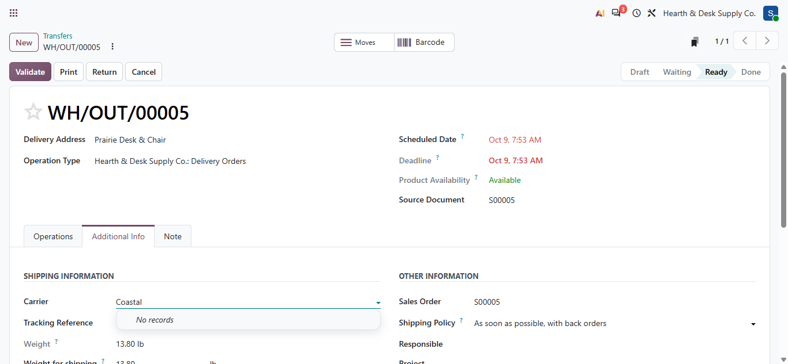

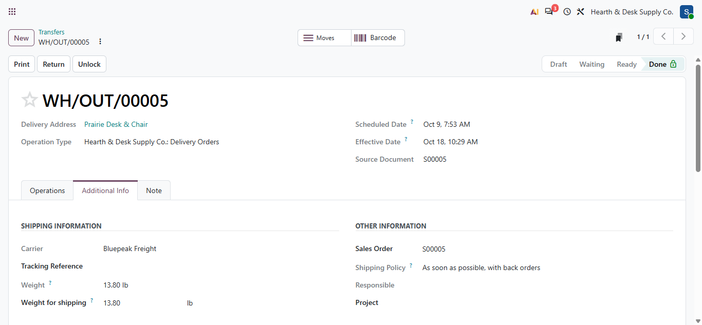

**6. Accounts payable and the close-out find (I3).** Two bills were paid before export so the data shows paid and open side by side. The export review then caught that Greenline's PO had been received but never billed. The bill was posted on 10/22, matched 100% to the PO and both receipts.

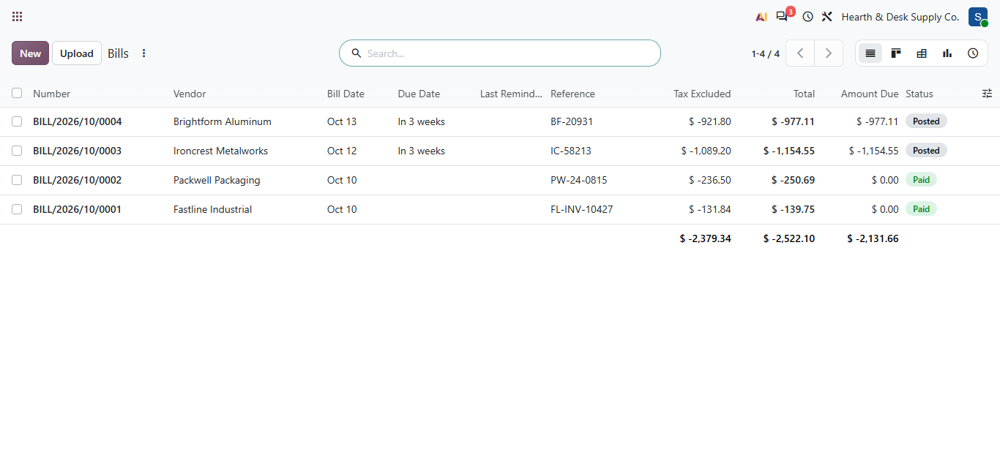

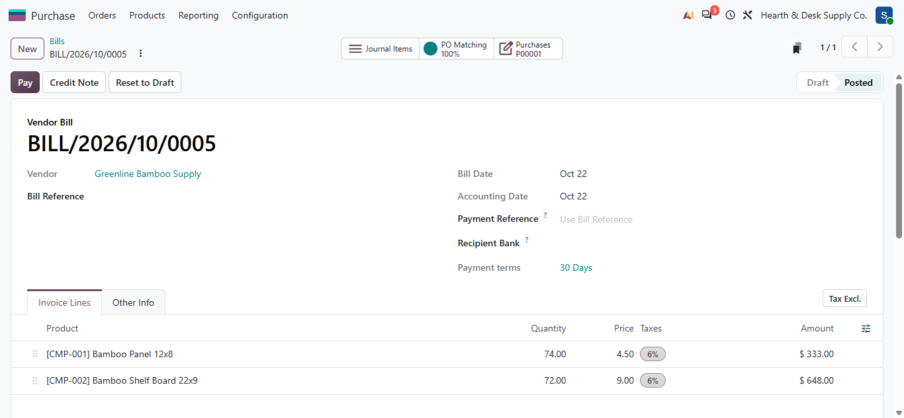

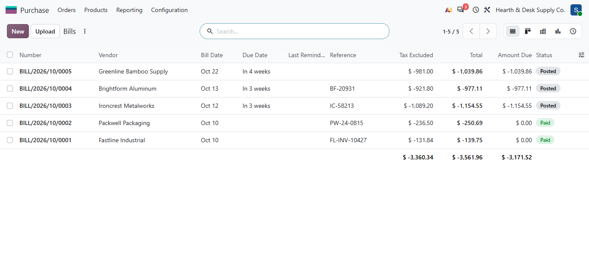

**7. Export, dashboard, delete.** Data was pulled through Odoo's JSON-RPC API into CSV, the workbook formulas and dashboard were built on those exports, and the trial database was deleted once everything was captured.

---

# Tools Used

- Odoo 20 (Inventory, Purchase, Manufacturing, Sales, Accounting)
- Excel (Tables, structured-reference formulas, charts, Gantt via conditional formatting)
- Playwright MCP for browser work in the live trial, JSON-RPC for exports
- Python (pywin32 for Excel automation, python-docx for the status reports)

---

# Author

**Sawandi Kirby**

Data Analytics & Business Intelligence
Benchline Analytics - Data intelligence for organizations that mean business.

- GitHub: https://github.com/visualkirby
- LinkedIn: https://linkedin.com/in/sawandi-kirby
- Kaggle: https://kaggle.com/sawandikirby
